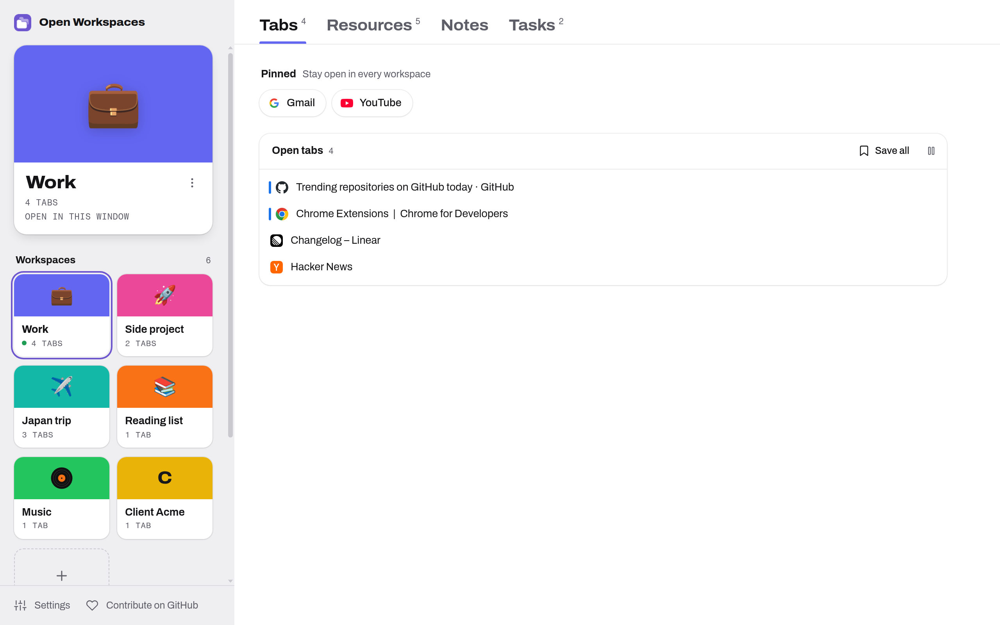
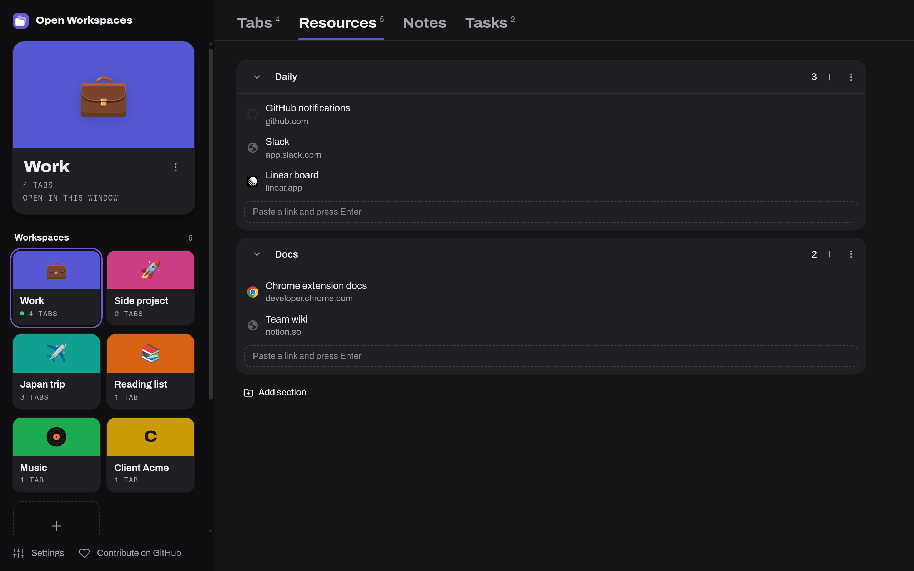
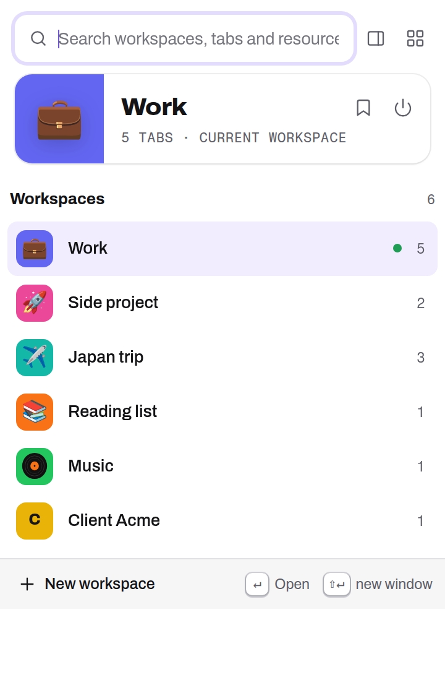
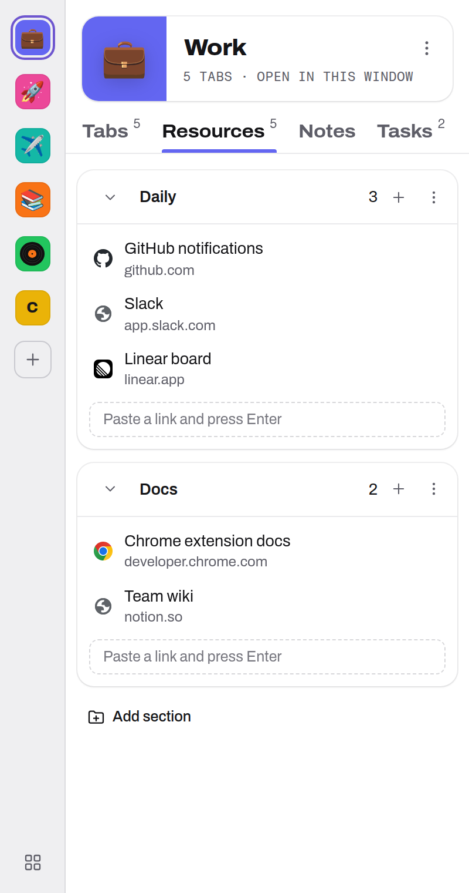
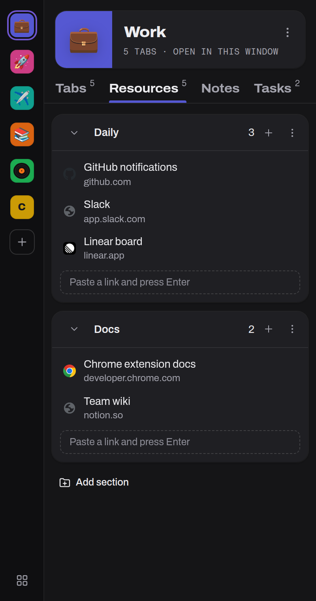

<p align="center">
  
</p>

<h1 align="center">Open Workspaces</h1>

<p align="center">
  <strong>Free and open-source workspaces for your browser tabs.</strong><br />
  Unlimited workspaces, resources, notes, tasks and tab suspension. No account, no paywall, no tracking.
</p>

<p align="center">
  <a href="#install">Install</a> ·
  <a href="#features">Features</a> ·
  <a href="#keyboard-shortcuts">Shortcuts</a> ·
  <a href="#development">Development</a> ·
  <a href="README.pt-BR.md">Português</a>
</p>

<p align="center">
  
  
</p>
<p align="center">
  
  
  
</p>

---

## Why?

Workspace managers like Workona are great until you've spent ten minutes organizing your tabs and hit a paywall on the number of workspaces. Open Workspaces does the same core job **with no limits**, keeps **all your data in your own browser** and is **MIT-licensed**, so anyone can audit, fork or improve it.

## Features

- **Unlimited workspaces.** Each workspace is a set of tabs with a name, a color (preset or custom) and an icon: an emoji, its initial or an image you upload (PNG, ICO, SVG, JPG, WebP).
- **Home tab.** A small pinned tab with the extension icon sits at the left of every window. Click it to see the workspace of this window and switch to any other in one click; after a switch the window stays on this page, with the workspace's last used tab already loaded behind it.
- **Pinned tabs stay put.** Tabs you pin in the browser (Gmail, YouTube...) belong to the window and stay open in every workspace. Open an always-on site (Gmail, Outlook, WhatsApp, Slack, Teams, Discord, Spotify...) in an unpinned tab and the toolbar popup offers to pin it.
- **Switch in place.** Opening a workspace swaps the tabs of the current window (or opens a new window, your choice). Everything is saved automatically as you browse.
- **Never lose tabs.** Windows with unsaved tabs are never replaced; closing a workspace keeps its tabs saved; a window you reopen (Ctrl+Shift+T or after a browser restart) is re-linked to its workspace automatically.
- **Tab groups are preserved**, including title, color and collapsed state.
- **Resources:** keep important links in named sections per workspace. Drag and drop to reorder or move them between sections and workspaces, drag a tab in to save it, or paste a link.
- **Notes and tasks** for every workspace.
- **Quick switcher** (Alt+A): keyboard-first search across workspaces, saved tabs and resources.
- **Side panel** (Alt+S) with every workspace one click away.
- **Move tabs** to another workspace (Alt+T, right-click menu or drag and drop).
- **Quick looks elsewhere are free.** When you switch away, the workspace's tabs wait, still loaded, in a collapsed tab group at the end of the window (15 minutes by default, adjustable or off). Come back in time and they return in place, without a reload; unused for that long, they close (a tab playing sound waits for it to stop).
- **Keep tabs running.** Mark a tab with the lightning button (or right-click the page) and it keeps running while you're in another workspace: it waits in a collapsed tab group at the end of the window and comes back in place, without a reload.
- **Tab suspension** using the browser's native tab discarding: restored tabs load on demand, plus optional auto-suspend (keep at most N tabs in memory, or suspend after X minutes of inactivity) with exclusions for pinned tabs, tabs playing audio and a domain/URL list.
- **Archive, duplicate, reorder** workspaces.
- **Backup:** export everything to JSON and import it back (merge or replace).
- **Light and dark themes**, English and Brazilian Portuguese.
- **Private by design:** no servers, no analytics, no remote code. Data lives in `chrome.storage.local`.

## Install

### From source (works today)

1. [Download the latest release](../../releases) `.zip` and unzip it, or clone this repo.
2. Open `chrome://extensions` (or `edge://extensions`, `brave://extensions`…).
3. Turn on **Developer mode**.
4. Click **Load unpacked** and select the `extension/` folder (or the unzipped folder).
5. Pin Open Workspaces to the toolbar and press **Alt+A**.

Works in any Chromium-based browser version 116 or newer: Chrome, Edge, Brave, Vivaldi, Opera, Helium, Arc and others.

### Chrome Web Store

Coming soon.

## Keyboard shortcuts

| Shortcut | Action |
| --- | --- |
| <kbd>Alt</kbd> + <kbd>A</kbd> | Quick switcher / search |
| <kbd>Alt</kbd> + <kbd>T</kbd> | Save or move the current tab to a workspace |
| <kbd>Alt</kbd> + <kbd>N</kbd> | New workspace |
| <kbd>Alt</kbd> + <kbd>S</kbd> | Open the side panel |
| *(not set)* | Next / previous workspace, close workspace, open dashboard |

Change them at `chrome://extensions/shortcuts`. In the quick switcher, <kbd>↑</kbd><kbd>↓</kbd> navigate, <kbd>Enter</kbd> opens and <kbd>Shift</kbd>+<kbd>Enter</kbd> opens in a new window.

## How it works

- Every **window** can be bound to one **workspace**. The service worker listens to tab and tab group events and saves the window's tabs into its workspace (debounced, ignoring the tab churn while a switch is in progress and while a window is closing).
- **Switching** saves the current window, creates the target workspace's tabs (and groups), then closes the old ones. Inactive restored tabs are discarded as soon as their URL commits, so they cost no memory until clicked.
- **Window ids change after a browser restart**, so windows are matched back to workspaces by comparing their URLs.
- The **service worker is the only writer** of state. The popup, side panel and dashboard send it messages and re-render from `chrome.storage.onChanged`.

### Permissions

| Permission | Why |
| --- | --- |
| `tabs`, `tabGroups` | Read, save and restore your tabs and tab groups |
| `storage`, `unlimitedStorage` | Keep your workspaces locally, without size limits |
| `sidePanel` | The side panel UI |
| `contextMenus` | Right-click "save to / move to workspace" |
| `alarms` | Periodic check for auto-suspend |
| `favicon` | Show site icons without fetching them from the network |

See [PRIVACY.md](PRIVACY.md).

## Development

No build step: the `extension/` folder is the extension. The UI uses [Preact](https://preactjs.com) + [htm](https://github.com/developit/htm) (vendored, about 13 KB) so it runs as plain ES modules.

```bash
npm test          # unit tests (node:test, no dependencies)
npm run check     # manifest, referenced files and translation keys
npm run smoke     # end-to-end test in a headless Chromium with the extension loaded
npm run pack      # dist/open-workspaces-<version>.zip
```

`npm run smoke` needs a Chromium build that still accepts `--load-extension` (Chromium, Chrome for Testing, Helium, Brave…; branded Google Chrome 137+ ignores it). Point to it with `BROWSER=/path/to/chrome`. `SCREENSHOTS=1 npm run smoke` regenerates the README screenshots with demo data.

```
extension/
  manifest.json
  _locales/            translations (en, pt_BR)
  src/background/      service worker: state store, tab sync, switching, suspension, menus
  src/shared/          constants and pure data helpers (unit tested)
  src/ui/              shared UI: API client, components, workspace views, theme
  src/popup/           quick switcher
  src/sidepanel/       side panel
  src/dashboard/       full-page dashboard, settings, welcome page
scripts/               check, pack, smoke test, icon generator
tests/                 unit tests
```

## Roadmap

Ideas where help is very welcome:

- [ ] Optional sync between devices (bring your own storage: Google Drive, GitHub Gist, WebDAV…)
- [ ] Firefox port
- [ ] Import from Workona, Toby, OneTab and bookmarks folders
- [ ] Workspace templates
- [ ] More languages
- [ ] Chrome Web Store / Edge Add-ons listing

## Contributing

Issues and pull requests are welcome. Read [CONTRIBUTING.md](CONTRIBUTING.md) to get started; adding a translation is a great first contribution.

## License

[MIT](LICENSE). Not affiliated with Workona.
